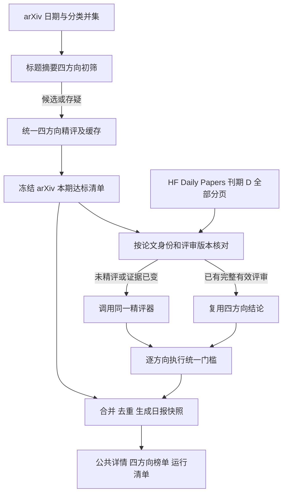

# Paper Hunt 每日论文架构设计：arXiv 主筛与 Hugging Face 补录

设计稿 · 2026-11-20

**建议按论文重构每日筛选与发布流程。** arXiv 主流程先找出值得读的论文，再逐篇核对同一期 Hugging Face（HF）Daily Papers。两路共用一份四方向评审和一套发布线。先确定论文在哪些方向有可核对的贡献，再决定它在各方向是否值得推荐。建议试行双门槛：方向相关度至少 3/4，阅读价值至少 4/6，方法与证据两项均至少 1 分。当日刊期按明确的来源日期结算，允许零入选。正式发布线通过带人工标签的日期回放确定。

## 一、现状和改动范围

当前工作树版本为 98dc772。run_daily.py 已经按所需分类并集预取 arXiv，但随后逐领域调用 rank_pipeline.py。selector.py 根据短语、分组词、排除词和优先级选出唯一主方向。四个方向中有三个要求正面证据出现在标题里。模型只会看到规则选中的方向，无法恢复在前面漏掉的论文。现有 lib/enricher.py 只对已筛出的论文匹配 HF 热度，按日期向后延伸最多五天，再按最高票数合并。这一步无法把漏掉的论文送回候选。入选依据分散在 selection_policy.yaml、topic_keywords.yaml 和 scoring_criteria.md 中。

旧综合分先对关键词主题分（40%）、模型五维均分（30%）、开源（10%）、社区热度、作者、会议、通用性（各 5%）加权，再乘领域惩罚系数。新颖性、潜在影响、范式转移和长期价值有重叠，摘要也很难支持关于长期价值的细粒度判断。代码和会议等信息在论文刚提交时经常缺失。旧流程用综合分排序，用独立的 domain_fit 门槛决定发布。

在本地数据索引的 535 条已收录记录上，按未取整的旧综合分计算，60 分线留下 217 条，70 分线留下 34 条，80 分线留下 0 条。此统计只能说明截断对旧榜单的影响。旧标注集上的好成绩也只说明旧领域规则在已知样例上的表现。

| 部分 | 设计决定 |
|---|---|
| 抓取与存储 | 复用日期和分类查询、限流重试、原始元数据缓存、Blob 和静态站点。校正调度日期覆盖，增加论文级评审缓存。 |
| 筛选与评分 | 用按日期和论文运行的统一入口接替四条独立筛选路径。规则专注于术语提示、审计和测试，模型负责有证据的多标签判断，程序执行门槛。 |
| 生成与前端 | 通过门槛后再翻译和提图。一篇论文一份内容，各方向列表引用它，并分别展示入选理由和分数。 |
| 运行环境 | 继续使用 Python 批处理、GitHub Actions 和 Next.js。先用文件和版本化清单实现，无需引入在线服务、向量数据库或常驻队列。 |

## 二、四个方向的编辑标准

人工标注、初筛、评审和详情页共用同一份每领域定义，包含研究问题、正反例和可接受的证据。每个方向列出的技术路线是可选分支；论文贡献落在其中一条即可。词表只帮助理解常见写法，允许只用系统名做标题，也允许摘要没有出现 Agent 字样但清楚描述了对应的交互机制。

| 方向 | 核心收录条件 | 接近但不够的例子 |
|---|---|---|
| Agent Evolution | 说明改变的对象、反馈或训练信号、更新如何影响后续能力。支持 harness 层工具、技能、代码或工作流的迭代；参数层基于轨迹、环境或验证结果的策略学习；两层联合演化。RSI 作为子标签，要求本轮改进作用于产生、选择或验证下一轮改进的机制。专门评测这些能力的论文也可收录。 | 静态编排库、通用编码跑分、仅重复执行固定提示的流程；一次普通微调不足以单独证明 RSI。 |
| Agent Memory | 有实质贡献于经验的写入、表征、读取、更新、归并、遗忘、记忆自进化或评测。覆盖参数化记忆、非参数化记忆和混合架构。持续学习可以通过跨任务保留经验、适应和遗忘测量入围；基础方法允许以交互任务或可验证的后续行为为证。 | 只增加上下文长度、只查静态知识库、只研究模型背诵预训练文本。只在背景里提到这些概念不会被否决。 |
| 电商 Agent 交互导购 | 两条主线。一是把用户表达、对话状态、预算或约束映射到目录、商品属性和具体候选。二是通过自然语言获取或更新偏好，使推荐、比较、排序或后续询问发生变化。允许单轮复杂需求、多轮澄清、语言反馈及专门检验这些能力的基准。 | 只有曝光点击日志的 CTR 改进、商品表征、广告排序；对既定商品列表生成话术却未利用用户需求做导购决策。 |
| 全模态／多模态 Agent | 语音或视频至少一种参与系统的核心机制，并对记忆、harness 设计或演化至少一项有贡献。包括跨模态事件记忆与调用、语音状态和工具调度、持续视频观察与行动、跨模态反馈驱动的策略更新。离线构建的视听记忆，只要被后续 Agent 任务使用，也可收录。 | 纯 ASR/TTS 指标、视频压缩、单次图像分类。仅标榜全双工或低延迟不能说明和这三个问题有关。 |

交叉必须分别有证据。视听 Agent 的长时记忆可以同时属于 Memory 和多模态。将交互经验写入权重并改变策略可以同时属于 Memory 和 Evolution。使用固定用户画像的导购工作可单独归入电商；只有对记忆机制也有贡献才增加 Memory 标签。

## 三、每日数据流程

**一期日报有一个刊期 D、两份来源快照和一份最终清单。** 对照基线是只使用 arXiv 主流程时本期会收录的“论文 × 方向”。对 HF 清单逐篇查缺，最后一次性发布。Paper Daily、Semantic Scholar 和专题库可用于离线选取评测样例；生产候选来源按本次需求限定为 arXiv 与 HF Daily Papers。

### 刊期和输入

- **刊期 D** 是日报的归档日期。HF 请求明确指定 date=D，以这份日期列表为准。试行建议在北京时间 D+1 日 14:00 生成 D 期，并按完成记录补跑。这样已越过该 UTC 日期的末尾；上游仍可能迟补，运行时间可按实测调整。页面分别显示论文首次发表日、HF 收录日、本站首次推荐刊期。当天上榜的旧论文有资格补录。
- **arXiv 主输入**复用现有分类并集、提交日期查询和原始缓存。处理到 D 为止的未完成日期，同时刷新最近 7 个提交日的可见记录；对较晚公开的版本以 ID 和版本识别新增或变化。连续刊期不中断，周末按实际输入处理。7 天是试行窗口，更长延迟由定向回放或 HF 发现补足。确认无提交、确认零入选、疑似上游空响应分别记录。
- **HF 补充输入**按 D 取全量清单，包括低票和零票论文。跟随接口返回的下一页直至末页，保留请求日期、获取时间、分页状态、原始条目和去重 ID。实测 2026-11-19 的首个响应有 52 篇，仍返回下一页链接，下一页才是空列表。翻页出错、页链接循环或异常结构标记为抓取不完整并重试。有效空榜可正常结算；工作日异常骤降或空榜追加复查，周末也实际查询。每次运行复看最近 7 个 HF 榜单日，按来源日期修订原刊，保存快照版本供审计。
- **身份与元数据**采用规范 arXiv ID 去除 v1/v2 等版本后缀作为论文主键，单独保存论文版本和内容哈希。HF 条目优先读取 paper.id 和作者摘要，按 ID 补全缺少的 arXiv 元数据，来源附带的投票、热度和 AI 导读不进入评审输入。不能可靠解析 ID 的条目进入异常清单，须完成解析或人工确认处理原因；标题相似只提供核对线索。
- **数据持久化**沿用每日期、分类的 arXiv 缓存，新增每刊期的 HF 快照。轻量的来源清单、版本化评审和已发布论文索引须跨 Actions 运行持久化。运行临时目录和有失效期的 CI cache 只用于加速。建议公共发布索引随现有 Git 快照提交，内部判断和回放输入使用具备留存期保障的私有对象存储。

### 主筛、补评、合并

1. arXiv 去重后，批量阅读每篇标题和摘要，各方向返回候选、存疑或无关；候选和存疑均进入精评。强机制词组可提升至候选，保留拒绝样本供抽检。
2. 每次精评同时输出**四个方向**的判断。依据不足时按需补读引言、方法、实验或论证段落，再记录证据位置和结论。把完整的领域判断、证据、阅读价值分项写入缓存。冻结当期仅依赖主流程的达标清单，用来区分主筛成果和 HF 净贡献。
3. HF 补录按下表处理。每条 HF 原始记录都必须关联到一个可解释结果。已经被主流程轻筛拒掉的 HF 论文直接送精评，不重复同一道轻筛。复用评审的条件是论文内容、四领域标准、提示词、模型版本和证据范围一致。只有旧版单方向评分时，重新按四方向评审。

| 核对结果 | 处理动作 |
|---|---|
| arXiv 当期已有完整评审，部分或全部方向已过线 | 复用结果并记录双来源；已入选方向不再新增。 |
| 主流程只有轻筛结果，或论文根本没出现在抓取分类／日期内 | 用 HF 条目补齐元数据，直接送四方向精评。过线的方向进入 HF 补录清单。 |
| 已有有效精评，四个方向均未过线 | 复用并记录拒绝原因。榜单排名和票数不触发额外加分。 |
| 过去刊期已推荐 | 已发布的“论文 × 方向”只更新来源。若因新版本或补齐评审而出现此前未发布的达标方向，只在该方向新增引用。旧论文首次通过则刊在本次补录所属的 D 期，同时展示原发表日。 |
| 内容证据不足、请求失败或模型漏回记录 | 前者按规则补读，仍不足则记为有理由的暂缓；后两者重试并保留未完成状态。 |

4. 以 **（论文 ID，方向）**求并集。每个发布键在全站索引中有唯一所属刊期。重跑本期可重建本期条目；键已属于其他刊期时仅附加来源记录。该约束同样适用于向前回放，避免晚发现的旧榜和已发布的新榜各刊一次。每篇一份共享详情，可从多个方向访问。每个领域卡片注明“arXiv 主筛”或“HF 补录”，论文详情可同时展示两种来源。后续发现同日或者更早的主来源，仅补充来源历史。已发布的首次推荐记录保持稳定，历史全量重建在独立索引中按日期顺序重算。
5. 门槛和榜单排序由程序确定。优先阅读价值，再看方向相关度，同分用稳定 ID。选中后只翻译和提图一次。提交前检查来源完整性、未决技术错误、分项分数、详情引用和各栏计数。临时目录的输出一次性切换为新快照。上游失败可先完成另一边的计算并保存结果；对外保留上一有效快照，故障恢复后续跑。翻译或图片失败可回退到英文与原文链接。

### 运行责任与成本

| 组件 | 输入与输出 |
|---|---|
| run_daily.py 与来源读取 | 解析刊期、补跑和锁，生成两份来源快照。arXiv 使用现有 fetcher 和 arxiv_cache；将 enricher.py 中获取 HF 清单的职责提至来源读取层。 |
| selector.py 与领域配置 | 在来源无关的题目和摘要上给出四领域初筛结果及命中证据。配置共用研究问题、正反例和术语。 |
| scorer.py 与程序化发布门槛 | 向同一模型提供论文证据与四方向量表；程序检查原文摘录、必填分项，计算发布集合。阈值变更只需重放结构化分项。 |
| 汇总、发布与静态页面 | 把 rank_pipeline.py 中的出版逻辑收敛到一个入口，生成公共详情、领域列表、期次索引和内部审计清单。Next.js 保留旧详情链接并读取新格式。 |

现有 CI 限时 120 分钟。影子运行分别测量 arXiv 初筛数、两路共享精评数、HF 独有送评数、缓存复用率、正文补查比例、模型成本和总耗时。预算不足时保存进度并续跑；只有重试和积压状态清晰，才能让“今天没有合适论文”具有可信含义。

## 四、评分和硬门槛

**方向相关度 F** 按论文与每个方向分别计算。使用整数档位，程序校验每个获选方向至少一段可定位原文证据。档位描述贡献的中心程度，分数不代表正确概率。

| F | 可判定的含义 |
|---|---|
| 0 | 没有该方向的实质内容 |
| 1 | 只在背景、数据集举例或通用组件中提到 |
| 2 | 确实使用了相关能力，但贡献在相邻问题，或主张只有应用可能性 |
| 3 | 至少一项明确贡献直接回答该方向的问题，允许与其他方向并列 |
| 4 | 该问题是论文的核心研究对象，并给出直接针对它的方法、系统、理论或评测 |

**阅读价值 V** 是针对该方向的阅读优先级，由三个 0–2 分整数相加。模型给出分项和事实依据，程序求和。开源链接、会议、作者、社区热度可用于查阅，不参与门槛。这里评价读者能从论文中获得什么；对只有摘要支撑的结论，详情页标明依据范围。

| 分项 | 0 分 | 1 分 | 2 分 |
|---|---|---|---|
| 方法或贡献的具体性 M | 只有愿景或宣称 | 能指出具体机制、协议、数据集、理论命题或有组织的综合工作 | 能解释相对已有做法的具体改变、可区分的假设或诊断设计 |
| 论据与主张的匹配程度 E | 缺乏对应论据 | 有直接评测、分析、理论推导或系统观察 | 有针对核心主张的对照、消融、独立条件验证、明确证明或可核对的系统性证据 |
| 对当前研究问题的启发 U | 无法指出能帮助做什么判断 | 给出一个可参考的设计、比较或失败条件 | 可据此做具体设计取舍、复用评测、解释机制边界或规划下一项实验 |

**试行发布条件为 F ≥ 3、V = M + E + U ≥ 4、M ≥ 1 且 E ≥ 1。** 任一条件未满足，该方向当天不输出。F = 4、V ≥ 5 的论文可标成优先阅读。示例：强相关的新记忆机制，具体性 2、证据 1、启发 1，可入选；即使研究问题很重要，只有方法主张、没有支持论据，补读后 E 仍为 0 就暂缓。同一篇在两个方向上可以一个通过、一个未通过。没有固定每日篇数，也不按百分位凑数。

该线是带行为含义的设计起点。正式阈值、启发维度是否多余、各方向是否需要不同线，都应在校准集上和更简单的“相关即发布”基线比较。先试公共门槛，只有持续出现同类偏差且独立验证有改善才引入领域例外。

## 五、数据契约与迁移

- 每篇保存规范 ID、来源事件（arXiv 提交日／版本、HF 榜单日、快照、获取时间）、首次推荐刊期、四方向判断、贡献类型、领域 F、M/E/U、证据位置、理由、评审状态及规则版本。每条领域卡片只引用通过该方向门槛的评审；详情展示所有达标方向和一句具体入选理由。含拒绝样本的运行材料仅供评估。
- 保留现有 CLI 的日期、领域过滤和测试运行入口。指定单领域时共用整篇评审，发布只更新请求的日期与栏目；完整日报和局部回放都要原子更新索引，避免覆盖其他栏目。保持已有静态详情 URL，通过数据读取层兼容旧的按领域／日期目录和新的共享内容。旧历史标明评分版本，跨版本浏览按日期分组，避免混排未经校准的分值。
- 同步改 run_daily.py、rank_pipeline.py、lib/selector.py、lib/scorer.py、四个领域配置、评估脚本、前端数据读取与排序和 CI。新策略切换后，每日路径移除旧总分、唯一主方向和重复筛选。旧格式仅在历史读取及离线对照中保留。历史回填使用原始 arXiv 快照和对应刊期的 HF 清单，标注回放时点；只有已发布列表的日期须重新拉取完整输入，单凭旧列表无法找回漏检。
- 先在独立输出目录回放，随后影子运行，验收后一次切换默认生产路径。保留切换前的数据快照和发布版本以便回滚。历史回填与前向发布分开执行，避免历史计算阻塞日报。

## 六、如何证明结果改善

1. **建立符合新口径的标注集。** 对原始 arXiv 分类并集与同刊 HF 清单的并集采样，覆盖随机论文、被现有规则拒绝的论文、模型边界样本，以及每个子方向的正例和难负例。每篇逐方向标“是否符合”“是否值得日报推荐”和理由；同一论文可有多个正标签。以用户的阅读取舍为最终参照，分歧样本通过共同复核固定标准。展示分层结果；总体指标按原始抽样比例还原。
2. **设立固定回归样例。** Hyperagents 应进入 Evolution 并识别 RSI；TMEM 应可同时进入 Memory 和 Evolution；M3-Agent 应可同时进入 Memory 和多模态；Dialogue to Discovery 应进入电商。加入普通编码榜单、纯模型背诵、纯点击率排序、纯语音识别等难负例。这些样例验证定义，独立留出集按日期划分，同一 arXiv ID 的所有版本只进一组。
3. **分开评估漏抓和误推。** 记录已知种子能否被分类抓取覆盖、初筛对域内相关论文的召回、最终推荐对人工“值得推荐”的精确率和召回率，以及交叉样本标签覆盖率。另看每方向榜单前五篇的人工值得读比例、推荐数量、待核对率、失败率、成本与耗时。对被拒样本分层抽查，防止通过少发甚至零发虚增精确率。对模型重复判定和人工标注者之间的一致性做抽查；模型更换需重新验证阈值。
4. **阈值选择与放行。** 在开发集比较 F 门槛 2/3/4 和 V 门槛 3/4/5，保留分项底线，并和现行流程、全量精评的子样本对照。以每方向最终推荐精确率至少 90% 为拟定目标，在满足精确率的方案中争取推荐召回率至少 80%，初筛对相关论文的召回率目标至少 95%。使用冻结后的阈值在独立日期上只做验收，报告每方向分子、分母和 95% 区间；罕见方向样本不足就补样。种子样例通过、每方向指标达标且至少连续 7 天影子运行完整、可复跑、成本与耗时可接受后切换。7 天验证运行可靠性，不能代替足量标注。如果目标冲突，记录误收和漏收案例，调整标准后更换留出日期复验。
5. **验收运行语义。** 验证周末和失败日期补跑、同日重跑无重复、零入选生成明确空列表、缺失模型评审不会伪装成零入选、局部回放不覆盖其他方向、交叉论文翻译与提图各一次、旧链接可打开。设置高于正常范围的候选量进行压力回放，确认工作流有能力按时完成。

6. **单独验收 HF 净补录。** 在相同冻结日期和阈值下比较“仅 arXiv”和“arXiv 加 HF”。逐日、逐方向列出 HF 清单唯一篇数、未进 arXiv 原始集的篇数、初筛漏掉后救回数、复用评审数、重复发表拦截数和净新增推荐数。净新增按论文与按“论文 × 方向”分别统计。HF 补录精确率以人工认可的补录对数除以抽检的补录对数；增量召回以两路相对同一组人工应推荐样本的差额计算。HF 获得完整处理结论的覆盖率要求 100%，公开重复的同方向推荐为零。
7. **用实际榜单检验日期和失败语义。** 固定 2026-11-19 的 52 篇清单及其末页，另存周末有效空榜。覆盖旧论文当日上榜、HF 收录但轻筛拒绝、同篇跨领域、上一期已发、来源在补抓时迟到、跨页重复、分页中断、HF 故障后续跑。验证在模型和输入不变时两次运行产生相同论文和方向集合。抽检 HF 中的领域近邻，特别是只提到购物、没有用户偏好证据的论文。

正式分界取决于用户对“值得推荐”的标注及真实每日负载。未完成校准前，4/6 为候选发布线，90% 等指标为验收目标。系统可以追溯每个入选判断，也能度量遗漏和误推；未知论文上的准确率仍需持续抽检。

### 回放对照的来源

- 现行规则和综合分可分别从 [selector.py](../../../pipeline/lib/selector.py)、[rank_pipeline.py](../../../pipeline/rank_pipeline.py) 和 [scorer.py](../../../pipeline/lib/scorer.py) 复核。统计口径为本地 [index.json](../../../web/public/data/index.json) 所引用列表中的 total_score，按记录统计。
- Evolution 和 Memory 边界样例见 [Hyperagents](https://arxiv.org/abs/2603.19461) 和 [Scaling Self-Evolving Agents via Parametric Memory](https://arxiv.org/abs/2606.04536)。多模态交叉样例见 [M3-Agent](https://arxiv.org/abs/2508.09736)。导购样例取自仓库的 [Dialogue to Discovery](../../../web/public/data/agent-e-commerce/2026-06-23/2606.24194.json)。

- HF 按刊期查询的运行样例见 [2026-11-19 日期接口](https://huggingface.co/api/daily_papers?date=2026-11-19&limit=100)。原有热度匹配实现见 [enricher.py](../../../pipeline/lib/enricher.py)。
